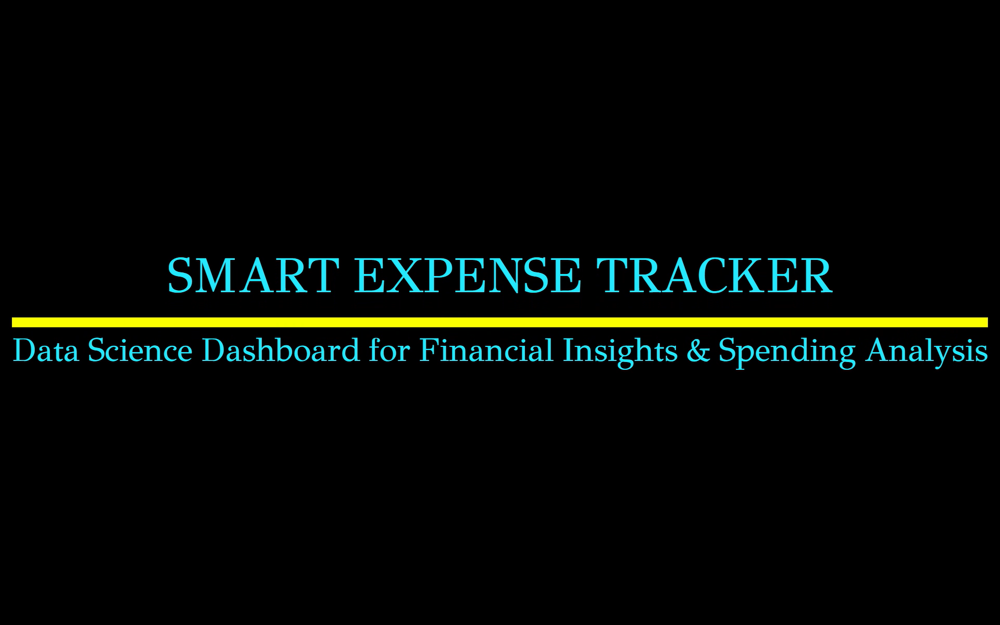
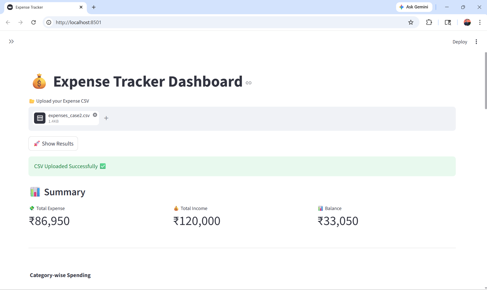
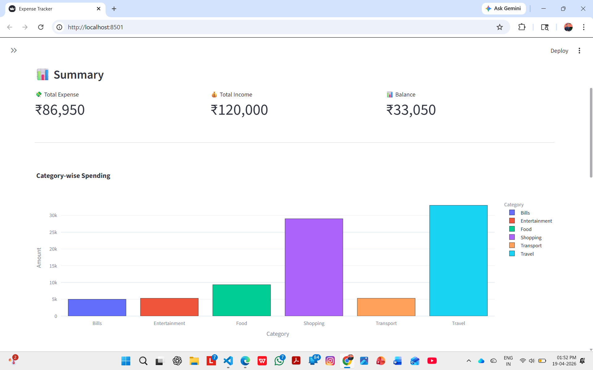
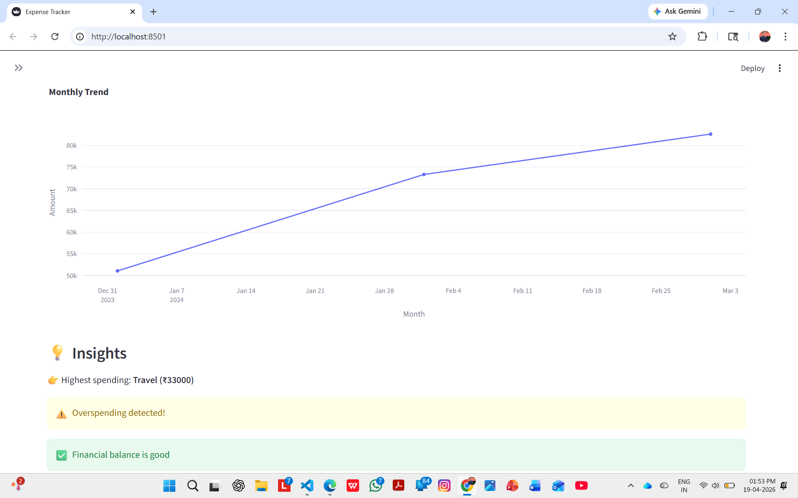
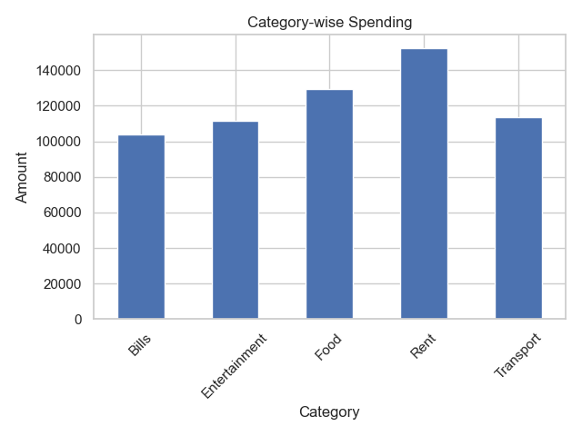
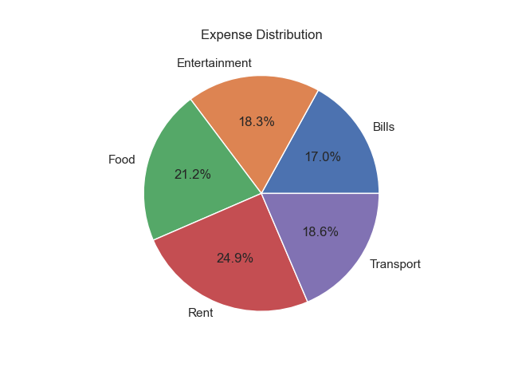
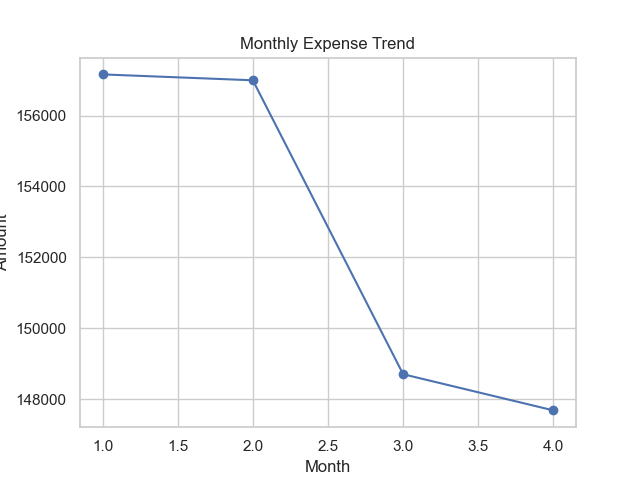
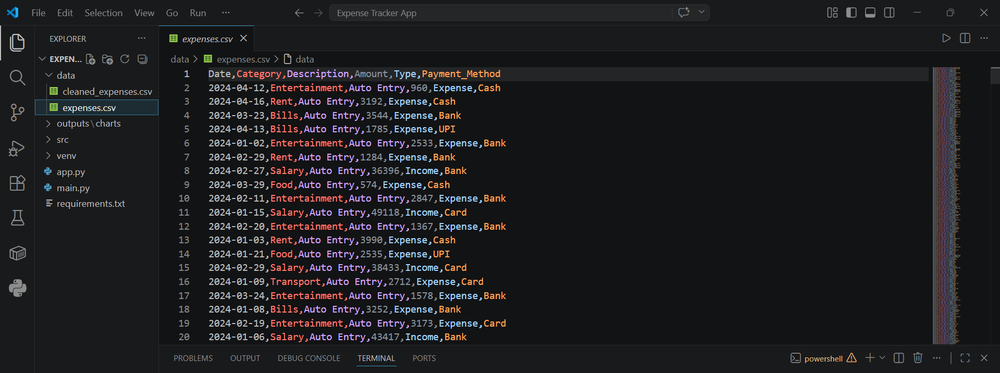
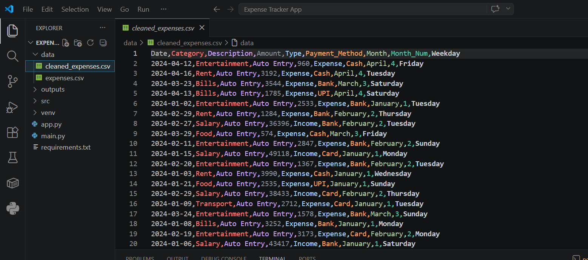

# 📊 Expense Tracker Dashboard (Data Science Project)

---

## 📌 Overview

This project is a **complete end-to-end Expense Tracker Analytics System** built using Python and Streamlit.

It converts raw financial transaction data into:

* 💰 Expense & Income summaries  
* 📊 Interactive dashboards  
* 📈 Spending trends  
* ⚠️ Overspending detection  
* 📌 Decision-ready financial insights  

---

## 🎥 Demo Video

---

## 📊 Dashboard Preview

---

## 🛠 Problem Statement

Individuals and businesses face challenges:

* ❌ Hard to track daily expenses  
* ❌ No clear category-wise insights  
* ❌ Difficulty in identifying overspending  
* ❌ Lack of visual financial analytics  

---

## ✅ Solution

This system:

* Cleans and processes expense data  
* Tracks income vs expenses  
* Generates interactive charts  
* Detects overspending patterns  
* Provides real-time dashboard insights  

---

## 🏭 Industry Relevance

| Industry        | Use Case                          |
| --------------- | --------------------------------- |
| FinTech Apps    | Personal finance tracking         |
| Banking         | Customer spend analytics          |
| Startups        | Expense monitoring                |
| Accounting      | Financial reporting               |
| Individuals     | Budget planning & saving insights |

---

## 📊 Business Impact

* ⚡ Faster financial decisions  
* 📉 Reduced manual tracking  
* 📈 Better spending control  
* 🧠 Data-driven budgeting  

---

## ⚙ Tech Stack

* **Language:** Python  
* **Data Processing:** Pandas, NumPy  
* **Visualization:** Plotly, Matplotlib  
* **Dashboard:** Streamlit  

---

## 📊 Dataset

Synthetic Expense Dataset

### Features:

* Date  
* Category  
* Description  
* Amount  
* Type (Income / Expense)  
* Payment Method  

---

## 🏗 System Architecture

Raw Data → Data Cleaning → Feature Engineering → Analysis → Visualization → Insights → Dashboard

---

## 📁 Project Structure

EXPENSE TRACKER APP/
├── data/
│   ├── cleaned_expenses.csv
│   ├── expenses_case2.csv
│   └── expenses.csv
├── images/
│   ├── bar_chart.png
│   ├── cleaned_data.png
│   ├── dash4.1.png
│   ├── dash4.2.png
│   ├── dash4.3.png
│   ├── expense-tracker-dashboard-demo.mp4.mp4
│   ├── pie_chart.png
│   ├── raw_data.png
│   ├── thumbnail4.1.png
│   └── trend_chart.png
├── outputs/
│   └── charts/
│       ├── category_spending.png
│       ├── monthly_trend.png
│       └── pie_chart.png
├── src/
│   ├── generate_data.py
│   └── visualization.py
├── venv/
├── app.py
├── main.py
└── requirements.txt

---

## ⚙ Installation & Setup

git clone https://github.com/maheshbhakre/expense-tracker-dashboard.git

cd expense-tracker-dashboard

python -m venv venv
venv\Scripts\activate

pip install -r requirements.txt

---

## 🖥 Usage

### Step 1: Generate Dataset

python src/generate_data.py

### Step 2: Run Processing

python main.py

### Step 3: Run Dashboard

streamlit run app.py

---

## 📊 Key Visualizations

### 🔹 Category-wise Spending

---

### 🔹 Expense Distribution

---

### 🔹 Monthly Trend

---

## 📸 Data Processing Proof

### 🔹 Raw Dataset

---

### 🔹 Cleaned Dataset

---

## 🧠 Key Insights

* Food & Shopping are top spending categories  
* Overspending detected in high-expense scenarios  
* Monthly trend shows spending spikes  
* Balance helps track financial health  

---

## 👨‍💻 Author

Mahesh Bhakre

---

## 🌐 CONNECT WITH ME

---

## ⭐ NOTE

This project demonstrates:

* Data Cleaning  
* Feature Engineering  
* Data Analysis  
* Visualization  
* Dashboard Development  

---

## 🚀 Future Improvements

* Real-time expense tracking  
* Mobile app integration  
* AI-based spending prediction  
* Budget alerts system  
* Financial goal tracking  

---

## 🎯 Interview Tip

“I built an end-to-end Expense Tracker Dashboard that processes transaction data, analyzes spending patterns, detects overspending, and visualizes insights through an interactive Streamlit dashboard.”