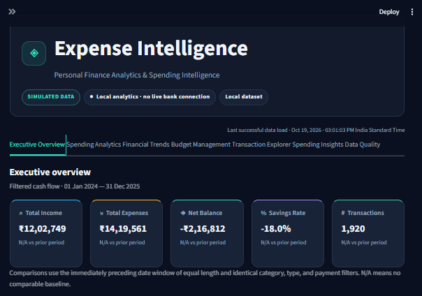
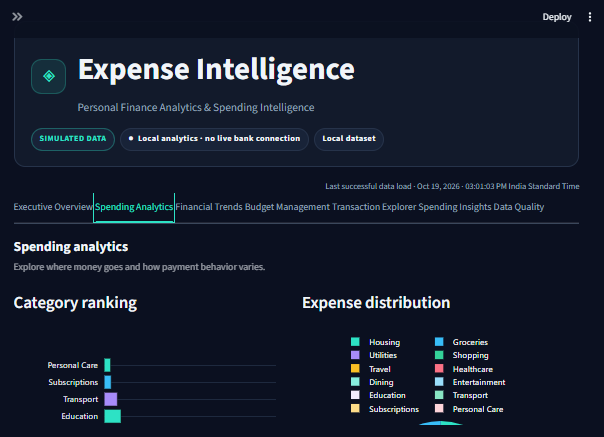
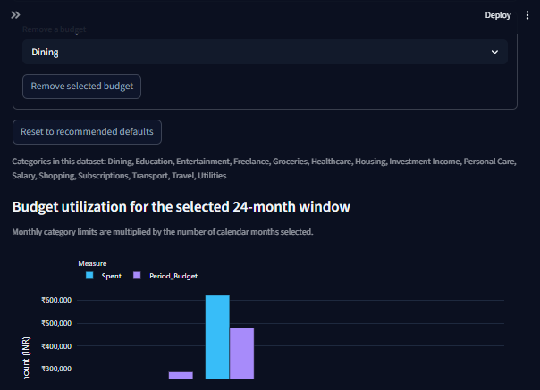
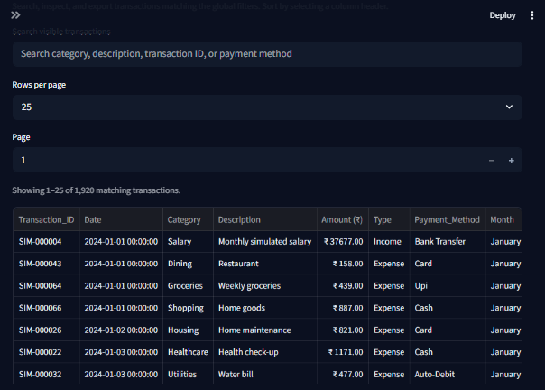

# 💹 Expense Intelligence

### Personal Finance Analytics & Spending Intelligence


---

## 📌 Overview

**Expense Intelligence** is an end-to-end personal finance analytics project
built with Python, Pandas, Plotly, and Streamlit. It turns transaction data
into an interactive dashboard for exploring income, expenses, cash flow,
budgets, and spending patterns.

The project includes a reproducible synthetic dataset and supports user-uploaded
CSV files. It is a local analytics application—not a live banking service or
an AI-powered financial adviser.

---

## 📊 Dashboard Preview

Screenshots below were captured from the running dashboard:

| Executive overview | Spending analytics |
| --- | --- |
|  |  |

| Budget intelligence | Transaction explorer |
| --- | --- |
|  |  |

---

## 🛠 Problem

Transaction files can be difficult to use for day-to-day analysis:

- Raw CSV data is hard to interpret at a glance.
- Inconsistent columns, invalid dates, and duplicate rows can distort totals.
- Category and month-to-month patterns take time to discover manually.
- Budgets, unusual transactions, and recurring costs are difficult to review in
  static spreadsheets.

## ✅ Solution

Expense Intelligence provides a reusable data pipeline and interactive
dashboard to:

- Validate, normalize, and clean transactions with a row-quality summary.
- Explore filtered income, expenses, balance, savings rate, and transaction
  counts.
- Visualize category, monthly, weekday, and payment-method patterns.
- Compare spending with configurable monthly category budgets.
- Review rule-based recurring costs and potential IQR outliers.
- Search and export filtered transactions.

---

## 🏭 Industry Relevance

| Area | Example application |
| --- | --- |
| Personal finance | Understand spending and monthly cash flow |
| FinTech analytics | Explore transaction categories and payment patterns |
| Data engineering | Validate, standardize, and summarize CSV records |
| Business intelligence | Monitor budgets, trends, and category metrics |
| Data science portfolios | Demonstrate reproducible data generation, analysis, and visualization |

## 📈 Project Outcomes

- Reproducible, fixed-seed synthetic data generation.
- Reusable cleaning and analytics functions separate from the UI.
- Interactive visual analysis across seven dashboard sections.
- Automated tests for the data pipeline, analytics, budgets, and UI helpers.

All sample financial values are simulated and are not representative of a real
person or account.

---

## ⚙️ Tech Stack

- **Language:** Python 3.10+
- **Data processing:** Pandas, NumPy
- **Interactive visualization:** Plotly
- **Static visualization:** Matplotlib, Seaborn
- **Dashboard:** Streamlit
- **Testing:** pytest

---

## 📂 Dataset

The default dataset is synthetic and deterministic:

- **Transactions:** 1,920
- **Coverage:** January 2024–December 2025 (24 months)
- **Generation:** 80 transactions per month, using a fixed default seed
- **Transaction types:** Income and Expense
- **Income sources:** Salary, freelance work, and investment income
- **Expense categories:** Groceries, housing, utilities, transport, healthcare,
  dining, entertainment, shopping, subscriptions, education, travel, and
  personal care
- **Payment methods:** UPI, card, cash, bank transfer, and auto-debit

### Transaction fields

| Field | Description |
| --- | --- |
| `Transaction_ID` | Stable identifier for each generated transaction |
| `Date` | Transaction date |
| `Category` | Income source or expense category |
| `Description` | Simulated transaction description |
| `Amount` | Positive amount; `Type` determines whether it is income or expense |
| `Type` | `Income` or `Expense` |
| `Payment_Method` | Payment method |
| `Month`, `Month_Num`, `Weekday` | Date features derived during cleaning |

Amounts are stored as positive magnitudes. The `Type` field determines their
cash-flow meaning; negative and zero amounts are rejected during cleaning.

---

## 🏗️ Architecture

```text
Synthetic data or uploaded CSV
              │
              ▼
     Validation & cleaning
              │
       ┌──────┴──────┐
       ▼             ▼
  Analytics      Data quality
       │
       ▼
 Streamlit dashboard ──► Interactive Plotly charts and filtered CSV export
       │
       └───────────────► Optional static chart generation
```

### Project structure

```text
expense-intelligence-platform/
├── app.py
├── main.py
├── generate_data.py
├── visualization.py
├── requirements.txt
├── README.md
├── .streamlit/
│   └── config.toml
├── data/
│   ├── raw/
│   └── processed/
├── src/
│   ├── expense_tracker/
│   │   ├── analytics.py
│   │   ├── budgets.py
│   │   ├── data_cleaning.py
│   │   ├── data_generator.py
│   │   ├── forecasting.py
│   │   ├── insights.py
│   │   └── ui.py
│   ├── generate_data.py
│   └── visualization.py
├── tests/
├── assets/
│   └── screenshots/
├── docs/
└── outputs/
    └── charts/
```

### Main modules

| Module | Responsibility |
| --- | --- |
| `src/expense_tracker/data_generator.py` | Generate reproducible synthetic transactions |
| `src/expense_tracker/data_cleaning.py` | Parse, validate, normalize, and clean CSV transactions |
| `src/expense_tracker/analytics.py` | Financial summaries, categories, trends, budgets, recurrence, and outliers |
| `src/expense_tracker/insights.py` | Build explainable spending insights |
| `src/expense_tracker/forecasting.py` | Calculate a descriptive trailing-average expense baseline |
| `src/expense_tracker/budgets.py` | Validate and persist local JSON budget settings |
| `src/expense_tracker/ui.py` | Reusable FinTech theme, header, KPI, and chart styling |
| `app.py` | Streamlit dashboard and user interactions |
| `main.py` | Clean the sample data and print a summary |
| `visualization.py` | Generate static charts |

---

## 📊 Dashboard Sections

1. **Executive Overview** — Income, expenses, net balance, savings rate,
   transactions, and recent activity.
2. **Spending Analytics** — Category ranking and distribution, payment-method
   analysis, and weekday/category patterns.
3. **Financial Trends** — Monthly income, expenses, cash flow, and descriptive
   next-month estimate.
4. **Budget Management** — Edit, remove, or reset monthly category budgets and
   review utilization and overspending.
5. **Transaction Explorer** — Search, inspect, sort, and export filtered
   transactions; add entries for the current session.
6. **Spending Insights** — Highest-spending categories, changes, recurring-cost
   candidates, and unusual transactions.
7. **Data Quality** — Source, valid/removed row counts, and cleaning details.

Global date, category, transaction-type, and payment-method filters update the
applicable metrics and charts. The navigation includes refresh and filter-reset
actions.

---

## 🧠 Analytics Methodology

- **Savings rate:** `(income − expenses) / income × 100`; zero income is handled
  safely.
- **Recurring expenses:** A rule-based candidate requires a matching category
  and description, similar amounts, and observations across multiple months.
  This is a heuristic, not confirmation of a subscription.
- **Unusual transactions:** Expense amounts above the category-specific
  `Q3 + 1.5 × IQR` fence are flagged for review. These are candidates, not
  fraud findings.
- **Budget utilization:** Filtered category spending is compared with the
  monthly budget over the selected calendar months.
- **Moving-average estimate:** A trailing three-observed-month average is
  displayed only when enough data is available. It is descriptive, not a
  validated predictive model.
- **Period comparisons:** KPI comparisons use the immediately preceding date
  window of equal length and the same category, type, and payment filters.

---

## 🧹 Data Cleaning

- Supports common aliases for required CSV columns.
- Parses dates and numeric amounts safely and reports invalid records.
- Normalizes transaction types and category labels.
- Removes exact duplicates and repeated transaction IDs.
- Rejects missing critical fields and non-positive or invalid amounts.
- Shows input, valid, removed, and categorized removal counts.
- Does not overwrite the original uploaded file.

---

## ⚙️ Installation

Clone the repository and move into its folder:

```powershell
git clone https://github.com/maheshbhakre/expense-intelligence-platform.git
cd expense-intelligence-platform
```

Create and activate a virtual environment in Windows PowerShell:

```powershell
python -m venv venv
.\venv\Scripts\Activate.ps1
python -m pip install -r requirements.txt
```

If script activation is restricted, call the environment's Python directly:

```powershell
.\venv\Scripts\python.exe -m pip install -r requirements.txt
```

---

## 🖥️ Usage

### Generate the reproducible sample data

```powershell
python generate_data.py
```

This writes `data/raw/transactions.csv` and does not overwrite uploaded data.

### Clean and summarize transactions

```powershell
python main.py
```

Cleaned data is written to `data/processed/transactions_cleaned.csv`.

### Launch the dashboard

```powershell
python -m streamlit run app.py --server.port 8502
```

Open [http://localhost:8502](http://localhost:8502).

### Generate static charts

```powershell
python visualization.py
```

### Run tests

```powershell
python -m pytest -q
```

The project was verified with **18 passing pytest tests**. Test results may
vary if the code or environment changes.

---

## 🔐 Budgets, Uploads & Privacy

- Edited budgets are stored locally in `data/budgets.json`; the file is ignored
  by Git. If it does not exist, the dashboard uses clearly labeled recommended
  starter values.
- Transaction entries added in the dashboard are kept in Streamlit session
  state only. They are not persisted to a database or file.
- Uploaded CSVs are processed in memory. The app does not save or overwrite
  the original upload.
- CSV export is an explicit download action.
- Use only synthetic data or financial data you are authorized to process, and
  run the app in a suitable private environment.

---

## ⚠️ Limitations

- This is a local, single-user analytics prototype. It has no authentication,
  multi-user database, bank connection, or transaction reconciliation.
- Budget defaults are examples and should be adjusted by the user.
- Recurring-cost and IQR rules can produce false positives and false negatives.
- The moving-average estimate is not a trained or validated forecasting model.
- The application is not financial, tax, or investment advice.

For the implementation audit and detailed completion notes, see
[`docs/PROJECT_AUDIT.md`](docs/PROJECT_AUDIT.md),
[`docs/PHASE_1_REPORT.md`](docs/PHASE_1_REPORT.md), and
[`docs/UI_UPGRADE_REPORT.md`](docs/UI_UPGRADE_REPORT.md).

---

## 👨‍💻 Author

**Mahesh Bhakre**

[GitHub](https://github.com/maheshbhakre) ·
[LinkedIn](https://www.linkedin.com/in/maheshbhakreds1242) ·
[Portfolio](https://saimfsd.github.io/mahesh-portfolio/)

---

## 🎯 Interview Summary

> “I built a reproducible personal-finance analytics application that validates
> transaction data, computes explainable spending and budget metrics, and
> presents interactive insights in a Streamlit dashboard.”

---
